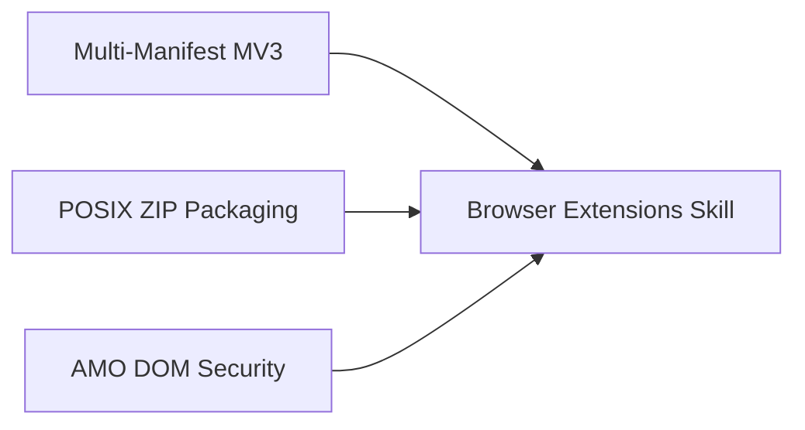

# ⚙️ Browser Extensions Agent Skill

## 🎯 Capacidades de la Habilidad

## 📋 Protocolo de Auditoría (`$ext:audit`)

1. **Arquitectura Multi-Manifest**: Verificar separación `manifest.chrome.json` vs `manifest.firefox.json` con build step de staging. En Firefox 2024+, validar `data_collection_permissions` y `strict_min_version >= 142.0` si soporta Android.
2. **Empaquetado Multiplataforma**: Verificar que el script de empaquetado fuerce separadores `/` (POSIX) usando `[System.IO.Compression.ZipArchive]` en Windows o `zip`/`web-ext build` en Unix, prohibiendo `Compress-Archive`.
3. **Seguridad DOM (`web-ext lint`)**: Auditar cero usos de `innerHTML` con interpolación de variables; exigir `createElement`, `textContent`, `append()` y `replaceChildren()`.

## 📝 Persistencia y Salida Activa (`overview/work/skill/`)
Registrar hallazgos en `overview/work/skill/browser-extensions.md`.
